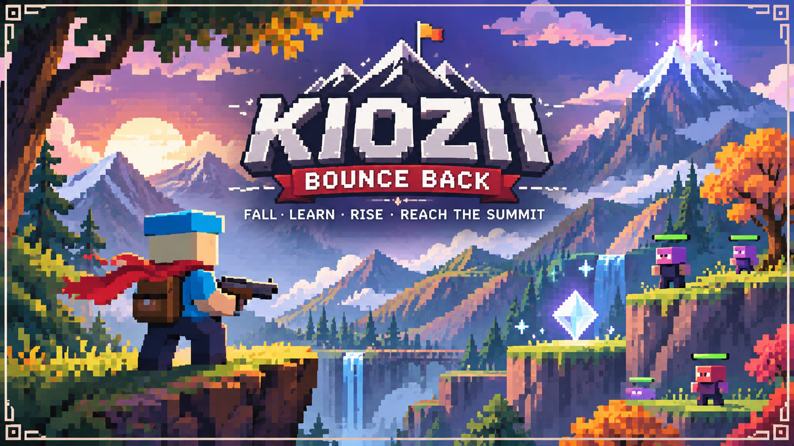
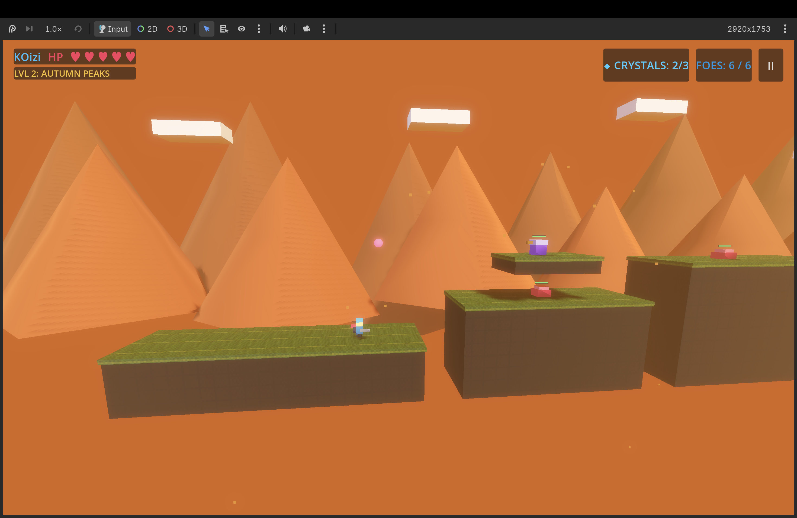
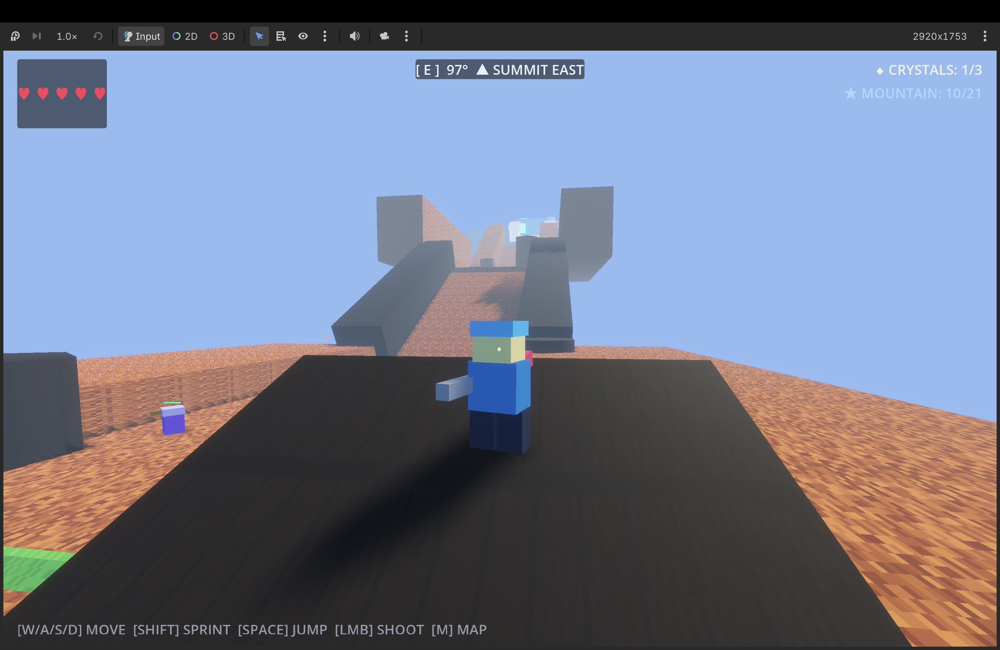

# KIOZII — BOUNCE BACK
### 3D Open-World Mountain Adventure

[](https://spanzzzy.itch.io/kiozii)
[](https://godotengine.org)
[](https://spanzzzy.itch.io/kiozii)

> **"Fall. Learn. Rise. Reach the Summit."**

🎮 **Play Online / Download on itch.io**: [https://spanzzzy.itch.io/kiozii](https://spanzzzy.itch.io/kiozii)



**KIOZII** is a fantasy-inspired 3D mountain action-adventure game developed in Godot 4. Players embark on an ascent across seven connected, seamless mountain biomes—overcoming hostile mountain sentries, perilous cliffs, and the multi-phase Summit Overlord to claim victory.

The central theme is resilience: setbacks, falls, and damage are not failures, but learning steps. With the **Second Wind** comeback mechanic, players bounce back from adversity stronger and faster.

---

## Screenshots

| Classic 2.5D | 3D Open World |
| :---: | :---: |
|  |  |

---

## Technical Specifications
- **Engine**: Godot Engine 4.7.2 (Forward+ / 3D Scene Pipeline)
- **Programming Language**: GDScript
- **Default Resolution**: 1280x720 (Windowed / Fullscreen Toggleable)
- **Performance Profile**: Optimized for low-end hardware (60 FPS cap, VSync OFF, lightweight procedural materials, zero viewport overhead)

---

## How to Play & Run the Game

### 🌐 Play in Browser (itch.io)
Play the official web release directly in your browser:  
👉 **[https://spanzzzy.itch.io/kiozii](https://spanzzzy.itch.io/kiozii)**

### In Godot Editor:
1. Launch **Godot Engine 4 (v4.3 or newer)**.
2. Click **Import** and select the `kiozii/project.godot` file.
3. Click **Import & Edit**.
4. Press **F5** (or click the **Play** button in the top right corner) to start the game from the Main Menu.

### From Command Line:
```bash
# Run the game in windowed mode
godot --path kiozii

# Run the game in headless mode with automated QA test suite
godot --path kiozii --headless res://tests/test_qa_runner.tscn
```

---

## Controls

All controls are fully rebindable in the in-game **Settings** menu.

| Action | Primary Key / Input | Secondary / Controller |
| :--- | :--- | :--- |
| **Move Forward** | `W` | `Up Arrow` |
| **Move Backward** | `S` | `Down Arrow` |
| **Move Left** | `A` | `Left Arrow` |
| **Move Right** | `D` | `Right Arrow` |
| **Jump** | `Spacebar` | *(Buffered + 0.12s Coyote Time)* |
| **Sprint** | `Left Shift` | Speed multiplier |
| **Look / Rotate Camera** | `Mouse Movement` | Third-Person SpringArm |
| **Shoot** | `Left Mouse Button` | `J` key |
| **Toggle Camera** | `C` | Switch perspective |
| **World Map** | `M` | Open/close map overlay |
| **Pause / Menu** | `Escape` | Pause menu |

---

## Main Gameplay Features

### 1. Interconnected 3D Mountain World (7 Distinct Regions)
- **Region 1 — Green Highlands** ($Y = 0\text{m}$): Rolling green foothills, stone bridge, river channel, starting shrine.
- **Region 2 — Autumn Peaks** ($Y = 18\text{m}$): Golden amber terraces, overlook shelves, sniper sentries.
- **Region 3 — Rocky Canyon** ($Y = 38\text{m}$): Sandstone cliffs, natural hoodoos, armored golem patrols.
- **Region 4 — Frozen Ridge** ($Y = 64\text{m}$): Glacial crevasses, ice arch bridge, snowy ridges.
- **Region 5 — Crystal Mountains** ($Y = 90\text{m}$): Subterranean cavern archway, glowing quartz spires, cavern altar.
- **Region 6 — Ember Summit** ($Y = 118\text{m}$): Basalt formations, flowing lava river channel, stepping stone bridge.
- **Region 7 — The Final Summit** ($Y = 142\text{m}$): Celestial amphitheater arena, runic monoliths, victory dais and portal.
- **Continuous Traversal**: All regions are connected by natural mountain passes with $0\text{m}$ vertical step ($24^\circ - 31^\circ$ natural inclines).

### 2. Platforming & Movement Overhaul
- **Capsule Physics**: Smooth `CapsuleShape3D` prevents catching on polygon edges and terrain steps.
- **Coyote Time (0.12s)**: Allows jumping up to 120ms after leaving a cliff edge.
- **Jump Input Buffering (0.12s)**: Buffers jump presses up to 120ms prior to touchdown.
- **Slope Snapping**: $50^\circ$ maximum climbable angle with continuous slope speed.

### 3. Collectibles & Checkpoints
- **21 Resolve Crystals**: Exactly 3 collectible crystals per region, modeled after traditional kaju katli rhombus diamonds.
- **Extra Heart Bonus**: Every crystal collected awards **+1 Extra Heart container** and heals the player, empowering Kiozii to tackle higher mountain tiers!
- **4 Mountain Altars**: Distinct checkpoint shrines with full health restoration upon resting. Press `[R]` or pause to instantly return to your active shrine.
- **Runic Boss Gate**: The Summit Gate to the final dais is sealed by an ancient runic barrier that only dissolves once the Summit Overlord is defeated in combat.

### 4. Enemies & Boss Overlord
- **Ridge Scout**: Ground patrol unit with leaping melee attacks.
- **Ridge Sniper**: Long-range elevation marksman firing aimed energy bolts.
- **Armored Golem**: Heavy high-durability mountain sentinel with defensive plating.
- **3D Billboard Health Bars**: Lightweight, dynamic color-coded health indicators (green $\to$ yellow $\to$ red) facing the camera with zero SubViewport overhead.
- **Summit Overlord (Final Boss)**: Aggressive, multi-pattern combat system (accurate chest-level energy fans, rapid twin-laser gatling bursts, lethal meteor ground slams with arena-wide floor shockwaves, and a 50% HP frenzy enrage mode).

### 5. Dual Game Modes
- **Classic 2.5D Summits [Complete & Verified]**: 7 fully polished, staged arcade challenges with completion grading, par times, and kill stats.
- **3D Open World [Experimental — Aimed for Future Scope]**: Explorable continuous 600m mountain climb from foothills to peak with free 3D camera controls and seamless biomes.

### 6. Settings & Accessibility
- Volume controls for Master, Music, and SFX.
- Graphics quality presets with LOW default for maximum compatibility.
- Fully rebindable keyboard and mouse controls.

---

## Automated QA Validation Suite

The project includes an automated 3-pass test suite located in `res://tests/`:
1. **Pass 1 — Static Audit**: Verifies scene nodes, 21 crystals, 4 checkpoints, capsule collision, and signal declarations.
2. **Pass 2 — Functional Testing**: Validates atomic crystal collection, zero duplicate notifications, UID save persistence, coyote time, and reachable platforming heights.
3. **Pass 3 — Regression Testing**: Validates all 7 classic summit levels, SettingsManager defaults, boss damage and knockback immunity, and complete 13-stage mountain path grounding.

Run the test suite headless at any time:
```bash
godot --path kiozii --headless res://tests/test_qa_runner.tscn
godot --path kiozii --headless res://tests/test_traversal_runner.tscn
```

---

## Asset Credits & Attributions

All art, audio, textures, and code in **KIOZII** are CC0, MIT, or custom-authored open-source assets.  
For full attribution details, please see [CREDITS.md](CREDITS.md).
